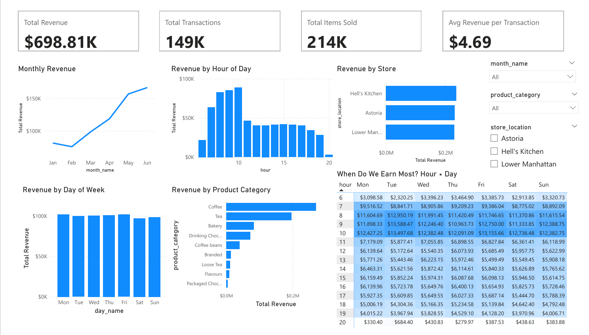

# Coffee Shop Sales Dashboard (Power BI)

An interactive Power BI dashboard that analyzes six months of sales from a 3-store coffee shop chain in New York. It shows when the shops earn the most, how the stores and products compare, and what the owner could do with that.



## Problem Statement

The owner of a 3-store coffee shop chain wants to understand when sales happen, which stores and products bring in the most revenue, and how to plan staffing better. This project turns the raw transaction data into a dashboard that answers these questions.

## Questions Answered

1. How does revenue change from month to month?
2. Which hours and days of the week are the busiest?
3. How do the three stores compare?
4. Which product categories earn the most?

## Dataset

- **Source:** Maven Analytics Data Playground, Coffee Shop Sales
- **Size:** 149,116 transactions, 11 columns
- **Period:** January to June 2023
- **Stores:** Astoria, Hell's Kitchen, Lower Manhattan

## Tools Used

- **Excel:** data checks and calculated columns
- **Power BI:** data modelling, DAX measures and the dashboard

## Process

**1. Data quality checks (Excel)**
- Confirmed the row count (149,116) matches the source.
- Checked every column for blank cells (none found) and the transaction ID column for duplicates (none found).
- Checked that the date and time columns were stored as real dates and times, not text.

**2. Feature engineering (Excel)**
- Created `revenue` (quantity x unit price), `hour`, `day_name` and `month_name`.
- Added `day_num` and `month_num` so months and days sort in calendar order in Power BI instead of alphabetically.
- One quantity cell contained a stray letter, which broke the revenue formula. I corrected it using the original source file.

**3. Data loading (Power Query)**
- Loaded the data into Power BI and set the correct data types, since the formula columns came in without a type. This also fixed an error where the quantity column was read as text.

**4. Modelling (DAX)**
- Wrote four measures: Total Revenue, Total Transactions, Total Items Sold and Average Revenue per Transaction.
- Set month and day columns to sort by their number columns.

**5. Dashboard design**
- KPI cards at the top, then charts for monthly revenue, revenue by hour, day of week, store and product category.
- Slicers for month, product category and store, which filter the whole page.

**6. Heat map (my own addition)**
- Built an hour x day matrix coloured by revenue, to show exactly when the shops are busiest. The monthly, hourly and daily charts only show one angle each, and this shows both together.

## DAX Measures

```
Total Revenue = SUM(Transactions[revenue])
Total Transactions = COUNTROWS(Transactions)
Total Items Sold = SUM(Transactions[transaction_qty])
Avg Revenue per Transaction = DIVIDE([Total Revenue], [Total Transactions])
```

## Key Numbers

| Total Revenue | Transactions | Items Sold | Avg Revenue per Transaction |
|---|---|---|---|
| $698.81K | 149K | 214K | $4.69 |

## Findings

- **Growth:** revenue dipped slightly from January to February, then rose every month. June revenue was more than double February.
- **Morning rush:** 7 to 10 AM brings in about 46% of total revenue, and the pattern is the same on every day of the week, weekends included.
- **Afternoon and evening:** revenue falls to about half after 11 AM and stays flat through the afternoon. The 8 PM hour earns very little, about $2.9K over six months across all three stores.
- **Days and stores:** all seven days and all three stores earn about the same, so the hour of the day matters far more than the day or the store.
- **Products:** Coffee and Tea earn the most, followed by Bakery. Packaged chocolate, flavours and loose tea add very little.

## Recommendations

- Schedule the most staff from 7 to 10 AM at all three stores, every day of the week.
- Use lighter staffing from 11 AM onwards.
- Review the 8 PM hour, but check costs first, because this data only has revenue and no profit.

## Limitations

- The data covers only six months (January to June 2023), so I can't tell whether the growth is seasonal or what caused it.
- There is no customer or cost data, so the analysis is about revenue only.

## Repository Structure

```
coffee-shop-sales-dashboard/
├── data/        Excel file with the added columns
├── dashboard/   Power BI file (.pbix) and preview image
└── README.md
```

To explore it, download the `.pbix` file from the `dashboard` folder and open it in Power BI Desktop.
